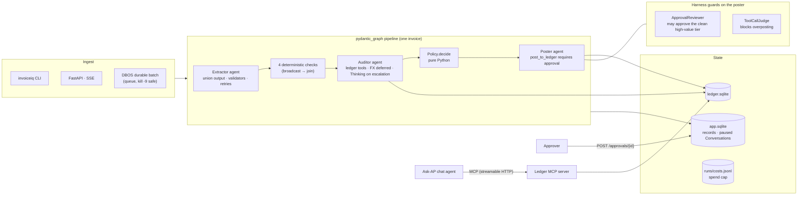

# InvoiceIQ

Accounts-payable automation for Indian GST invoices, built on **Pydantic AI V2**:

1. read a PDF, scan or email,
2. extract a structured invoice,
3. check it against GST rules and the ledger,
4. let an auditor agent investigate,
5. decide in plain Python,
6. post to the ledger only after an approval (a person's, the policy's, or a reviewer model's).

Project 1 of 7 in a framework-comparison series. The spec is [p1-pydantic-ai-invoice-intelligence.md](p1-pydantic-ai-invoice-intelligence.md), and every design trade-off is recorded in [docs/decisions.md](docs/decisions.md) (D0–D24).

## Quick start

```bash
uv sync
cp .env.example .env                       # put your ANTHROPIC_API_KEY in it
uv run python scripts/gen_mockdata.py      # 40 invoices + ledger + ground truth (deterministic; also committed)
uv run pytest                              # ~200 tests, $0: no real model is ever called
uv run invoiceiq serve                     # API on http://127.0.0.1:8000
```

Without a key, `pytest`, `invoiceiq mcp`, `postings`, `costs` and `reset` still work. Anything that builds an agent says what's missing and exits.

## Architecture



The graph itself, generated from code, is in [docs/pipeline.md](docs/pipeline.md).

| Layer | Where | Pydantic AI feature |
|---|---|---|
| Extract | [agents/extractor.py](src/invoiceiq/agents/extractor.py) | union `output_type`, output validators + `ModelRetry`, multimodal input, `Caching` |
| Investigate | [agents/auditor.py](src/invoiceiq/agents/auditor.py), [capabilities/](src/invoiceiq/capabilities/) | custom `Capability` (ledger tools), `defer_loading` (FX), `Thinking` escalation, `OnlineEvaluation` |
| Decide | [policy.py](src/invoiceiq/policy.py) | none, on purpose: money decisions are plain Python |
| Post | [agents/poster.py](src/invoiceiq/agents/poster.py), [approvals.py](src/invoiceiq/approvals.py) | deferred tools (approve / deny / edited amount), `Conversation` persistence, Harness reviewer + judge |
| Orchestrate | [pipeline/graph.py](src/invoiceiq/pipeline/graph.py), [pipeline/batch.py](src/invoiceiq/pipeline/batch.py) | `GraphBuilder` broadcast/join/decisions, `.map()`, `DBOSDurability` |
| Chat | [agents/ask_ap.py](src/invoiceiq/agents/ask_ap.py), [mcp_server.py](src/invoiceiq/mcp_server.py) | `MCP` capability, an MCP server, stored conversations |
| Reliability | [reliability.py](src/invoiceiq/reliability.py) | `FallbackModel`, `ConcurrencyLimitedModel`, timeouts, `UsageLimits` |
| Cost and traces | [capabilities/cost.py](src/invoiceiq/capabilities/cost.py), [telemetry.py](src/invoiceiq/telemetry.py) | `Hooks`, Logfire / OpenTelemetry |
| Evals | [evals/](evals/) | `pydantic_evals` datasets, agentic evaluators, `LLMJudge`, regression gate |

## Results

Measured on the 40-invoice mock corpus. Every scenario has a ground truth: clean, high value, duplicates, price drift, blocked or unknown vendor, GST type mismatch, math errors, stale dates, USD imports, a scan, an email and a quotation.

| | Haiku 5.5 | Sonnet 5.5 |
|---|---|---|
| Extraction, field accuracy (40, ±₹1) | **1.00** | 1.00 |
| Extraction, invoice vs not-an-invoice | 1.00 | 1.00 |
| Audit, finding recall / precision (39) | **1.00 / 1.00** | 1.00 / 1.00 |
| Audit, decision matches ground truth | 1.00 | 1.00 |
| Narrative, LLM-judge pass rate (10) | 0.80 | — |
| Eval cost: extraction + audit | $0.058 | $1.27 (22×) |
| Pipeline: decisions correct, cost per invoice | 40/40, ~$0.0014 † | — |
| Pipeline latency, p50 / p95 per invoice | _run `scripts/benchmark.py`_ | — |
| Durable batch: kill -9 mid-run, then resume | 40/40, 0 double postings, no re-spend | — |

† From the M7 `run --parallel` (40 invoices, $0.0575); before the M8 guards. `scripts/benchmark.py` reproduces the whole row, including latency.

Haiku is the default: Sonnet bought nothing on this corpus for about 22× the price. The project's total live spend through M8 was **$2.06** of a $6 cap.

## Demo (about 10 minutes, about $0.10)

```bash
uv run invoiceiq run --fresh                     # 1. all 40 through the graph, one at a time, vs ground truth
uv run invoiceiq pending                         # 2. what's waiting for a person
uv run invoiceiq approve inv-024 --user asha     #    approve one (or --amount 1000 for a partial posting)
uv run invoiceiq deny inv-025 --user asha --note "price not agreed"
uv run invoiceiq postings                        #    the ledger, with who approved each posting

uv run invoiceiq serve &                         # 3. the API: ingest one invoice, then follow its SSE stream
uv run python -c "import httpx; print(httpx.post('http://127.0.0.1:8000/invoices', json={'path': 'data/invoices/inv-001.pdf'}).json())"
uv run invoiceiq watch <invoice_id printed above>   #    graph steps, then the extraction's JSON as it grows

uv run invoiceiq mcp --http 127.0.0.1:8765 &     # 4. the ledger over MCP, and a chat that uses it
uv run invoiceiq chat --user asha --mcp-url http://127.0.0.1:8765/mcp

uv run invoiceiq batch --fresh --batch-id demo   # 5. a durable batch: kill -9 it, rerun the same line, it resumes
uv run python scripts/crash_test.py              #    or let the script do it, with fake models, for $0

uv run invoiceiq costs                           # 6. what all of that cost, by agent and model
```

Evals, run manually (they cost money). Each writes `runs/evals/latest-*.json`:

```bash
uv run python -m evals.extraction      # field accuracy, line-item F1, kind
uv run python -m evals.audit           # recall/precision per kind, decisions, tool use from spans
uv run python -m evals.narrative       # an LLM judge on 10 narratives
uv run python -m evals.compare         # exits 1 if any metric drops more than 3 points from evals/baseline.json
```

## Layout

```
src/invoiceiq/   agents/ capabilities/ pipeline/ repos/ · api.py cli.py mcp_server.py approvals.py policy.py
evals/           three datasets, custom evaluators, compare gate, baseline.json
scripts/         mock data, crash test, benchmark, experiments (caching, thinking, output modes)
tests/           $0: FunctionModel/TestModel fakes, ALLOW_MODEL_REQUESTS=False
docs/            decisions.md (D0–D24), pipeline.md (generated), observability.md
notes/           the learning journal and the framework comparison (written by the developer)
```

## Cost controls

- **Haiku by default**, with `max_tokens` set on every agent.
- **Spend cap:** `CostHooks` refuses a new run once `runs/costs.jsonl` reaches `P1_SPEND_CAP_USD`.
- **No double counting:** the cost ledger skips a response it has already recorded, so a durable replay isn't charged twice (D22).
- **`Caching` on every agent:** it saved 17% on the extractor and 46% on the auditor (M6).
- **Thinking only on escalation:** the auditor thinks only when its result disagrees with the deterministic checks.
