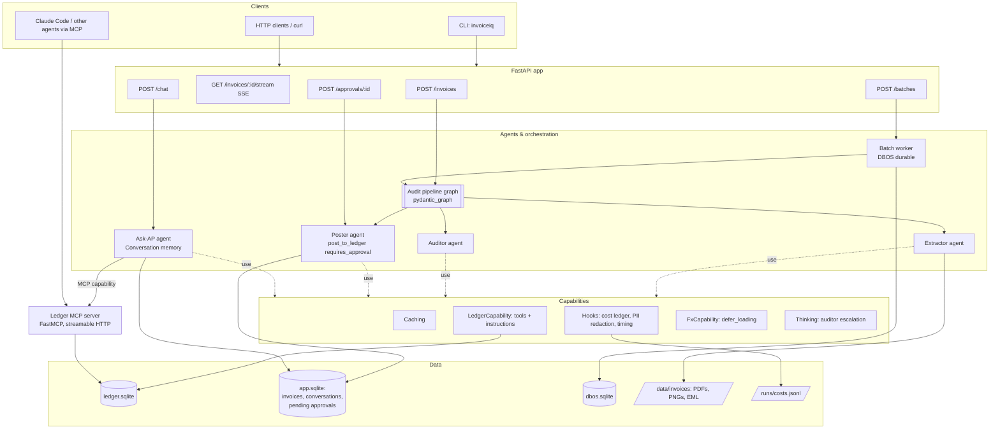
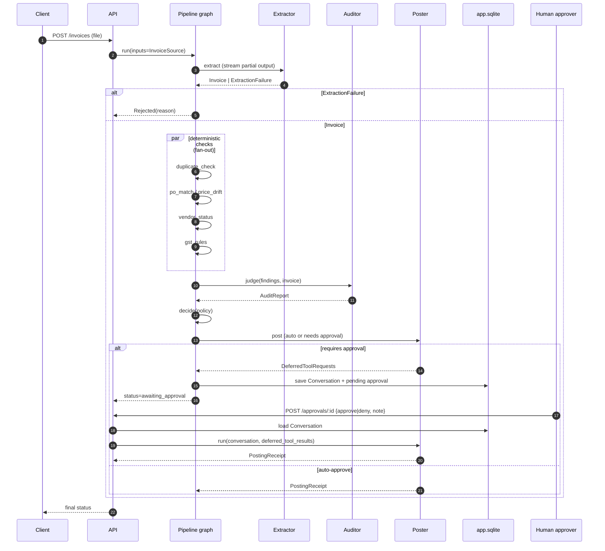
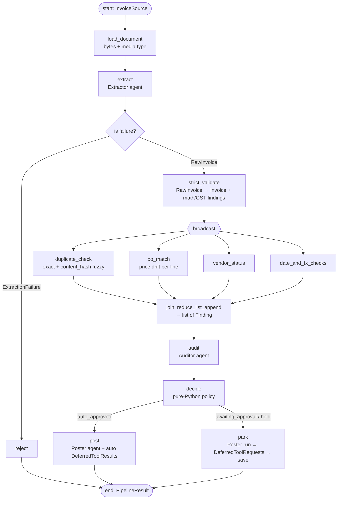
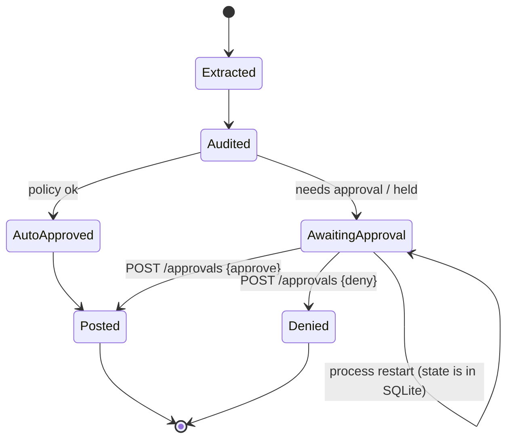

# P1 — Pydantic AI V2: Invoice Intelligence Platform

> **Detailed build spec, Project 1 of 7** in the agentic frameworks lab (see `agentic-frameworks-build-plan.md`).
> **Framework:** Pydantic AI **V2** (stable since 23 Jun 2026; this spec was written against ~v2.59) + `pydantic-graph` + `pydantic-evals` + `pydantic-ai-harness` (0.x)
> **Model provider:** Anthropic Claude via your own API key
> **Budget cap:** **$6** (enforced in code)
> **Estimated effort:** 1–1.5 weeks part-time
>
> This file supersedes Section 2 of the master plan.

---

## Table of contents
0. [Rules for Claude Code](#0-rules-for-claude-code)
1. [What you're building and why](#1-what-youre-building-and-why)
2. [Pydantic AI V2 primer: concepts this project must cover](#2-pydantic-ai-v2-primer)
3. [System architecture](#3-system-architecture)
4. [Domain: Indian GST invoices](#4-domain-indian-gst-invoices)
5. [Mock data specification](#5-mock-data-specification)
6. [Data models](#6-data-models)
7. [Agents](#7-agents)
8. [Capabilities and hooks](#8-capabilities-and-hooks)
9. [Orchestration: pipeline graph](#9-orchestration-pipeline-graph)
10. [Human approval (deferred tools)](#10-human-approval-deferred-tools)
11. [Durable batch processing (DBOS)](#11-durable-batch-processing-dbos)
12. [MCP: server and client](#12-mcp-server-and-client)
13. [HTTP API (FastAPI)](#13-http-api-fastapi)
14. [Reliability, limits and errors](#14-reliability-limits-and-errors)
15. [Observability](#15-observability)
16. [Testing strategy ($0 tests)](#16-testing-strategy-0-tests)
17. [Evals](#17-evals)
18. [Repository layout](#18-repository-layout)
19. [Configuration](#19-configuration)
20. [Milestones](#20-milestones)
21. [Budget plan](#21-budget-plan)
22. [Stretch goals](#22-stretch-goals)
23. [Learning journal](#23-learning-journal)
24. [Feature coverage matrix](#24-feature-coverage-matrix)
25. [Kickoff prompts](#25-kickoff-prompts)
26. [References](#26-references)

---

## 0. Rules for Claude Code

These rules are in addition to Section 0 of the master plan. The developer is learning, so they stay in control.

1. **One milestone at a time** (Section 20). At the end of each milestone, stop and give:
   - what was built
   - how to run it
   - which Pydantic AI concepts it used, and where in the code
   - the spend so far

   Then wait for the go-ahead.
2. **Verify before you write.** The code in this spec is *illustrative*, written against ~v2.59. V2 ships releases weekly, and the Harness is 0.x, so its APIs can move. For each milestone:
   - run `uv pip show pydantic-ai-slim pydantic-graph pydantic-evals pydantic-ai-harness`
   - check each API you'll use against the docs (pydantic.dev/docs/ai) or the installed source
   - list anything renamed, deprecated or moved **before** coding
3. **Use the native feature.** Don't hand-roll retries, output validation, approval flows, caching, usage limits or tracing. Pydantic AI has all of them. If you think hand-rolling is justified, ask first.
4. **Explain every primitive.** When you introduce a capability, hook, toolset, graph step or evaluator, add a one-line comment explaining *why it was chosen here*.
5. **Strict types.** Run Pyright in strict mode on `src/`. Remember the V2 generic default is `object`: use `RunContext[object]` for agents without deps, and annotate `Capability[...]` explicitly.
6. **$0 tests.** Unit tests never call a real model (Section 16). Live calls happen only in `scripts/` and `evals/`, and only when the developer runs them.
7. **Always set `max_tokens`.** In V2, the Anthropic model's default `max_tokens` was raised to the model's maximum. Leaving it unset can blow the budget.
8. Don't add dependencies outside Section 19.2 without asking.

---

## 1. What you're building and why

### 1.1 The product
**InvoiceIQ** is a backend service for a small Indian company's accounts-payable team. It does four things:

1. **Ingests** vendor invoices (PDF, scanned image, or email text).
2. **Extracts** fully typed invoice data, with GST-aware validation.
3. **Audits** each invoice against the company ledger to catch:
   - duplicates
   - price drift against purchase orders
   - unknown or blocked vendors
   - GST errors
   - arithmetic errors
4. **Decides**: it auto-approves clean low-value invoices, and routes everything else to a human approver. **Posting to the ledger always needs explicit approval.**

It also offers an **"Ask AP" chat** for questions like "why was INV-0042 flagged?" or "what did we pay Acme last quarter?", with conversation memory. Finally, it processes overnight **batches** durably: a crash mid-batch resumes where it left off.

### 1.2 Why this project for Pydantic AI
The domain exercises exactly what Pydantic AI is best at:

| Need in the domain | Pydantic AI feature |
|---|---|
| Messy documents in, strictly validated data out | `output_type`, Pydantic validators, output validators, `ModelRetry` |
| Agents need the DB, config and the current user | Typed dependency injection (`deps_type`, `RunContext`) |
| Posting money requires sign-off | Deferred tools (`requires_approval`), `DeferredToolRequests` / `DeferredToolResults` |
| Many independent checks per invoice | `pydantic_graph` GraphBuilder fan-out / join |
| Overnight batch must survive crashes | Durable execution (DBOS capability) |
| Cost-sensitive at scale | `Caching` capability, `UsageLimits`, cheap model by default |
| Has to be right, measurably | `pydantic_evals` datasets, custom and agentic evaluators |
| Other agents should reuse the ledger | MCP server and the `MCP` capability |

### 1.3 Non-goals
- No real ERP integration. The ledger is SQLite.
- No auth system. A fake `X-User` header identifies the approver.
- No OCR library: Claude reads PDFs and images natively.
- No frontend in the core milestones (one is a stretch goal).

### 1.4 What "done" looks like
- `uv run invoiceiq serve` starts an API that processes all 40 mock invoices.
- Extraction field accuracy is ≥ 95% on the eval set, using Haiku.
- All seeded anomalies are detected (recall 1.0 for duplicates, ≥ 0.85 overall), with ≤ 1 false positive per 10 clean invoices.
- Kill the batch worker mid-run, restart it, and it finishes with no duplicate ledger postings.
- `pytest` runs in < 30 s, with 0 model calls, and covers every agent and the graph.
- Total spend is ≤ $6.

---

## 2. Pydantic AI V2 primer

Claude Code should explain each of these concepts to the developer as it first uses it.

| Concept | One-liner | Where used here |
|---|---|---|
| **Agent** | Generic `Agent[Deps, Output]`: a model, instructions, tools and an output type. Reusable and stateless. | All agents (§7) |
| **Model string** | `'anthropic:claude-haiku-5-5'`. Strings without a provider prefix raise in V2. | `config.py` |
| **`output_type`** | Pydantic model, union, list or output function. Union members become separate output tools. | Extractor's union output |
| **Output modes** | Tool output (default), `NativeOutput` (provider JSON schema), `PromptedOutput` | Compared in M2 |
| **Output validator** | `@agent.output_validator`. Raise `ModelRetry` to make the model fix its output. | GST and arithmetic checks |
| **Deps / `RunContext`** | Typed dependency injection into tools, instructions and validators | DB, ledger, settings |
| **Tools** | `@agent.tool` (gets ctx) and `@agent.tool_plain`. The docstring becomes the description. | Ledger lookups |
| **Toolsets** | Groups of tools (`FunctionToolset`, `MCPToolset`), composable and filterable | Ledger toolset |
| **Capability** ⭐ | **The V2 core primitive.** Bundles instructions, tools, hooks and model settings, attached via `capabilities=[...]`. Can be deferred and loaded on demand. | Caching, Hooks, the ledger capability, the FX capability |
| **Hooks** | `before_*` / `after_*` / `wrap_*` / `on_*_error` around runs, model requests and tool calls | Cost ledger, PII redaction, timing |
| **Caching** | `Caching()` capability. Anthropic caches **nothing** without it. | Every agent |
| **Thinking** | Extended-reasoning capability | Auditor on hard cases |
| **Deferred tools** | `requires_approval=True`, then the run ends with `DeferredToolRequests`. Resume with `DeferredToolResults`. | Ledger posting |
| **Conversation** | `result.conversation` holds messages, running usage, an ID and pending deferred requests. Serialize with `ConversationTypeAdapter`. | Ask AP chat, paused approvals |
| **UsageLimits / timeout** | Request, token and tool-call caps; whole-run `timeout=` | All runs |
| **Error categories** | `ModelRateLimitError`, `ModelContextWindowExceededError`, … | Fallback handling |
| **FallbackModel** | Try model A, then fall back to B | Haiku → Sonnet on failure |
| **pydantic_graph** | `GraphBuilder`: typed steps, edges, broadcast / `.map()` fan-out, joins with reducers, Mermaid render | Audit pipeline |
| **Durable execution** | `DBOSDurability` (and Temporal, Prefect, …). One engine per agent. | Batch worker |
| **MCP** | `MCP` capability / `MCPToolset` client. You can also build servers that agents call. | Ledger MCP server |
| **TestModel / FunctionModel** | Fake models for tests; `agent.override(model=...)` | All tests |
| **pydantic_evals** | `Dataset`, `Case`, evaluators (custom, `LLMJudge`, `ToolCorrectness`, `TrajectoryMatch`, `MaxToolCalls`), `OnlineEvaluation` | §17 |
| **Logfire / OTel** | `logfire.instrument_pydantic_ai()`. Plain OpenTelemetry, so no account is needed locally. | §15 |
| **Harness** | Separate 0.x package of extra capabilities: SpendLimits, Guardrails, ApprovalReviewer, ToolCallJudge, StepPersistence, Memory… | Stretch / M8 |

### 2.1 Known V2 gotchas (from community testing)
- Constructing an agent with an `anthropic:` model **fails at construction time if `ANTHROPIC_API_KEY` is unset**. Tests set a dummy key, or build agents with `TestModel`.
- `RunContext[None]` fails strict type checking on an agent without deps. Use `RunContext[object]`.
- **Agentic evaluators silently score 0 if Logfire isn't configured.** You must call `logfire.configure(send_to_logfire=False)` and `logfire.instrument_pydantic_ai()`.
- `result.usage` is a property in V2, not a method.
- Give `on_change='append'` instructions a `name=`.
- `pydantic_graph.persistence` was **removed in V2**. For persistence, use stored `Conversation`s, Harness `StepPersistence`, or a durable engine.
- A first-run banner prints until instrumentation is configured. `PYDANTIC_AI_NO_BANNER=1` silences it.

---

## 3. System architecture

### 3.1 Component view



### 3.2 Request lifecycle (single invoice)



---

## 4. Domain: Indian GST invoices

The project uses Indian GST invoices. This makes validation rich and realistic instead of toy-like.

### 4.1 Rules the system must know (encode as validators and deterministic checks)

| Rule | Detail |
|---|---|
| **GSTIN format** | 15 characters: `^\d{2}[A-Z]{5}\d{4}[A-Z][1-9A-Z]Z[0-9A-Z]$`. The first 2 digits are the state code. |
| **Intra- vs inter-state** | Supplier state = buyer state → **CGST + SGST**, split equally. Different states → **IGST**. Mixing them is an error. |
| **Rates** | Common slabs are 0, 5, 12, 18 and 28%, per line item, via HSN/SAC code. |
| **Arithmetic** | Per line: `qty × unit_price = taxable_value`; `tax = taxable_value × rate`. Header totals must equal the sum of lines (±₹1 rounding). |
| **Invoice number** | Unique per supplier per financial year (Apr–Mar). |
| **Date sanity** | Not in the future; not more than 180 days old without a flag. |
| **Currency** | INR by default. Some import invoices are in USD/EUR, which triggers the FX capability (§8.4). |

> Claude Code: these rules are for synthetic test data. They are not tax advice and don't need to be legally exhaustive.

### 4.2 Business policy (drives the decision step)

| Condition | Decision |
|---|---|
| No findings and total ≤ ₹50,000 | **Auto-approve** and post |
| No findings and total > ₹50,000 | **Needs approval** (one approver) |
| Any `warning`-severity finding | **Needs approval**, with the findings attached |
| Any `critical` finding (duplicate, blocked vendor, GST mismatch) | **Hold**. Never post automatically; approval requires a note. |
| Extraction failure | **Rejected**, with a reason and the missing fields |

The policy lives in `policy.py` as pure Python (deterministic, unit-tested). The LLM explains decisions but **does not make the money decision**. That is a deliberate design lesson: keep LLMs out of the deterministic parts.

---

## 5. Mock data specification

Generated by `scripts/gen_mockdata.py` (seeded, deterministic, idempotent).

### 5.1 Ledger schema (`data/ledger.sqlite`)

```sql
CREATE TABLE vendors (
  vendor_id   TEXT PRIMARY KEY,
  name        TEXT NOT NULL,
  gstin       TEXT UNIQUE,
  state_code  TEXT NOT NULL,
  status      TEXT NOT NULL CHECK (status IN ('active','blocked','pending_kyc')),
  bank_last4  TEXT
);
CREATE TABLE purchase_orders (
  po_number   TEXT PRIMARY KEY,
  vendor_id   TEXT REFERENCES vendors,
  issued_on   DATE,
  status      TEXT CHECK (status IN ('open','closed','cancelled'))
);
CREATE TABLE po_lines (
  po_number   TEXT REFERENCES purchase_orders,
  line_no     INTEGER,
  hsn_sac     TEXT,
  description TEXT,
  qty         NUMERIC,
  unit_price  NUMERIC,
  gst_rate    NUMERIC,
  PRIMARY KEY (po_number, line_no)
);
CREATE TABLE posted_invoices (
  posting_id     TEXT PRIMARY KEY,
  vendor_id      TEXT REFERENCES vendors,
  invoice_no     TEXT,
  fy             TEXT,          -- e.g. '2026-27'
  invoice_date   DATE,
  total          NUMERIC,
  currency       TEXT,
  content_hash   TEXT,          -- normalized hash for fuzzy duplicate detection
  posted_by      TEXT,
  posted_at      TIMESTAMP,
  idempotency_key TEXT UNIQUE   -- prevents double-posting on durable retries
);
```

Our company's own GSTIN uses state code **19** (West Bengal).

### 5.2 Invoice corpus (`data/invoices/`), 40 items

| # | Category | Count | Notes |
|---|---|---|---|
| 1 | Clean, intra-state (CGST+SGST), PDF | 10 | Various vendors, 1–8 lines |
| 2 | Clean, inter-state (IGST), PDF | 6 | |
| 3 | Clean, high value (> ₹50k) | 3 | Should route to approval |
| 4 | **Exact duplicate** of an already-posted invoice | 2 | Same number and total |
| 5 | **Fuzzy duplicate** | 2 | Invoice number reformatted (`INV/26/042` vs `INV-26-042`), same lines |
| 6 | **Price drift** vs PO (> 5%) | 4 | One borderline at exactly 5% |
| 7 | **Blocked vendor** | 1 | |
| 8 | **Unknown vendor** (GSTIN not in DB) | 1 | |
| 9 | **GST type mismatch** (IGST on intra-state) | 2 | |
| 10 | **Arithmetic error** | 2 | Line total ≠ qty × price |
| 11 | **Scanned image** (PNG, slightly rotated / noisy) | 3 | Multimodal input |
| 12 | **Email-body invoice** (`.eml`, plain text) | 1 | |
| 13 | **Foreign currency** (USD import, no GST) | 2 | Triggers FX capability |
| 14 | **Not an invoice** (a quotation, a delivery challan) | 1 | Should yield `ExtractionFailure` |

Totals: 40 files. Categories 11–12 are *format* variants: make 2 of the scans clean and 1 contain a price drift, and make the email clean. Ground truth records which is which.

### 5.3 Ground truth
For every file there is `data/ground_truth/<file_id>.json`, containing:
- the full expected `Invoice` (or the expected `ExtractionFailure`)
- `expected_findings: [{kind, severity}]`
- `expected_decision`

This is the eval dataset source (§17).

### 5.4 Generation notes
- PDFs: `reportlab`, with 3 different layout templates (table-based, two-column, minimalist), so the extractor can't overfit to one layout.
- Scans: render the PDF to PNG (`pypdfium2`), then rotate ±3° and add noise (`Pillow`).
- Hindi/English mixed vendor names on 2 invoices, for realism.
- Seed: `20261029`.

---

## 6. Data models

`src/invoiceiq/models.py`. Illustrative; Claude Code must refine and verify.

```python
from datetime import date
from decimal import Decimal
from typing import Annotated, Literal
from pydantic import BaseModel, Field, field_validator, model_validator

GSTIN = Annotated[str, Field(pattern=r"^\d{2}[A-Z]{5}\d{4}[A-Z][1-9A-Z]Z[0-9A-Z]$")]
Money = Annotated[Decimal, Field(max_digits=14, decimal_places=2)]

class Party(BaseModel):
    name: str
    gstin: GSTIN | None = None
    address: str | None = None

    @property
    def state_code(self) -> str | None:
        return self.gstin[:2] if self.gstin else None

class LineItem(BaseModel):
    description: str
    hsn_sac: str | None = Field(None, description="HSN (goods) or SAC (services) code")
    qty: Decimal = Field(gt=0)
    unit: str | None = None
    unit_price: Money
    taxable_value: Money
    gst_rate: Literal[0, 5, 12, 18, 28] | None = None
    cgst: Money = Decimal(0)
    sgst: Money = Decimal(0)
    igst: Money = Decimal(0)

    @model_validator(mode="after")
    def check_math(self) -> "LineItem":
        if abs(self.qty * self.unit_price - self.taxable_value) > Decimal("1.00"):
            raise ValueError(f"qty×unit_price ≠ taxable_value for '{self.description}'")
        return self

class Invoice(BaseModel):
    """A successfully extracted vendor invoice."""
    kind: Literal["invoice"] = "invoice"
    supplier: Party
    buyer: Party
    invoice_no: str
    invoice_date: date
    po_number: str | None = None
    currency: Literal["INR", "USD", "EUR"] = "INR"
    line_items: list[LineItem] = Field(min_length=1)
    subtotal: Money
    total_tax: Money
    total: Money
    confidence: float = Field(ge=0, le=1, description="Self-assessed extraction confidence")

    @model_validator(mode="after")
    def check_totals_and_gst_type(self) -> "Invoice":
        ...  # sum of lines == subtotal; subtotal + tax == total; CGST/SGST vs IGST by state codes
        return self

class ExtractionFailure(BaseModel):
    """The document is not a valid invoice, or critical fields are unreadable."""
    kind: Literal["failure"] = "failure"
    reason: Literal["not_an_invoice", "unreadable", "missing_critical_fields"]
    missing_fields: list[str] = []
    detected_document_type: str | None = None

FindingKind = Literal[
    "exact_duplicate", "fuzzy_duplicate", "price_drift", "unknown_vendor",
    "blocked_vendor", "gst_type_mismatch", "math_error", "stale_date", "fx_unverified",
]

class Finding(BaseModel):
    kind: FindingKind
    severity: Literal["info", "warning", "critical"]
    message: str
    evidence: dict[str, str] = {}
    source: Literal["deterministic", "llm"]

class AuditReport(BaseModel):
    findings: list[Finding]
    narrative: str = Field(description="2-4 sentence plain-English explanation for the approver")
    suggested_decision: Literal["approve", "needs_approval", "hold"]

class Decision(BaseModel):
    outcome: Literal["auto_approved", "awaiting_approval", "held", "rejected"]
    reasons: list[str]

class PostingReceipt(BaseModel):
    posting_id: str
    idempotency_key: str
    posted_by: str
    posted_at: str
```

**Design lesson:** validation lives in Pydantic models. The *same* validators that reject bad API input also force the LLM to retry. Pydantic AI feeds the validation errors back to the model automatically.

---

## 7. Agents

All agents are module-level singletons in `src/invoiceiq/agents/`. Each one:
- takes its model from `config.models.dev` (overridable with `--final`)
- sets `model_settings={'max_tokens': ..., 'temperature': 0}`
- has an explicit `UsageLimits`
- has a `name=`, which is required for DBOS and for clean tracing

### 7.1 Extractor agent

| Property | Value |
|---|---|
| File | `agents/extractor.py` |
| Type | `Agent[ExtractDeps, Invoice \| ExtractionFailure]` |
| Model | dev model; `FallbackModel(haiku → sonnet)` on retry exhaustion (M7) |
| Input | `BinaryContent` (PDF/PNG) or text (email body), plus a short prompt |
| Deps | `ExtractDeps(company_gstin: str, today: date)` |
| Instructions | Static: role and field definitions. **Dynamic** (`@agent.instructions`): today's date and our company's GSTIN, so it knows which party is the buyer. |
| Output | **Union** → two output tools. Compare tool output vs `NativeOutput` in M2. |
| Output validator | Cross-checks the buyer GSTIN matches our company; if not, `ModelRetry("buyer GSTIN should be ours …")` |
| Retries | `output_retries=2` |
| Capabilities | `Caching()`, shared `CostHooks`, `PIIRedactionHooks` (redacts bank account numbers from logged prompts/outputs) |
| Limits | `UsageLimits(request_limit=4, total_tokens_limit=20_000)`, `max_tokens=2048` |
| Streaming | `agent.run_stream(...)` → `stream_output()` for partial `Invoice` objects over SSE (M5) |

Key instruction text (draft):
> You extract data from Indian GST invoices. Read every line item. Copy numbers exactly as printed; never compute or "fix" them, because downstream checks rely on catching vendor errors. If the document is not an invoice (a quotation, PO, challan or receipt), return ExtractionFailure. Dates are usually DD/MM/YYYY.

⚠️ **Important design point.** The `LineItem.check_math` validator would make the LLM "fix" a genuine vendor arithmetic error, which would hide category 10 anomalies. Resolve it like this:
- Use a *lenient* extraction model (`RawInvoice`, no arithmetic validators) for the extractor's output type.
- Run the strict validation in a deterministic graph step that *produces findings*.

Claude Code: implement it this way and explain the trade-off in the M2 summary. Validation-as-retry is great for format errors and harmful for content you need to audit.

### 7.2 Auditor agent

| Property | Value |
|---|---|
| File | `agents/auditor.py` |
| Type | `Agent[AuditDeps, AuditReport]` |
| Input | The extracted invoice plus the **deterministic findings** from the graph's fan-out checks |
| Deps | `AuditDeps(ledger: LedgerRepo, policy: Policy)` |
| Tools | Via `LedgerCapability`: `get_vendor(gstin)`, `get_po(po_number)`, `vendor_history(vendor_id, months)`, `search_posted(query)` |
| Job | (a) judge borderline cases (exactly 5% drift, fuzzy duplicates); (b) add LLM-sourced findings the rules miss; (c) write the narrative for the approver |
| Capabilities | `Caching()`, `CostHooks`, `LedgerCapability`, `FxCapability(defer_loading=True)` (§8.4). `Thinking()` is added **per run** only when the deterministic checks disagree or confidence < 0.8 (M6). |
| Limits | `UsageLimits(request_limit=6, tool_calls_limit=8)` |

### 7.3 Poster agent (the human-approval agent)

| Property | Value |
|---|---|
| File | `agents/poster.py` |
| Type | `Agent[PostDeps, PostingReceipt \| DeferredToolRequests \| str]` |
| Tools | `post_to_ledger(invoice_ref, amount, idempotency_key)`, **`requires_approval=True`**; `prepare_posting_summary(...)` (plain) |
| Behaviour | Prepares a posting summary, then calls `post_to_ledger`. When approval is needed, the run ends with `DeferredToolRequests`. |
| Auto-approve path | For policy-approved invoices, the graph resolves the approval with a `DeferredToolResults` it builds itself (policy, not LLM). This uses the same code path as a human approval. |
| Idempotency | `post_to_ledger` uses `INSERT … ON CONFLICT(idempotency_key) DO NOTHING` and returns the existing receipt. This is essential under durable retries (§11). |

Why use an agent for posting at all? To learn deferred tools in a realistic setting, and so the approver gets an LLM-written summary. Note the trade-off in the journal.

### 7.4 Ask-AP agent (conversational)

| Property | Value |
|---|---|
| File | `agents/ask_ap.py` |
| Type | `Agent[AskDeps, str]` |
| Tools | Reaches the ledger **through the MCP server** (`MCP` capability) rather than direct tools. This is deliberate, to learn MCP client integration. Also `explain_invoice(invoice_id)`, a local tool that reads the stored `AuditReport`. |
| Memory | `Conversation` stored in `app.sqlite` (`conversations` table, JSON column), keyed by `conversation_id`. Usage limits span the whole thread. |
| Instructions | Dynamic instruction with `on_change='append'` (and `name=`) for "current user + today", so changing values don't break the prompt cache |
| Limits | `UsageLimits(request_limit=30)` **per conversation** |

---

## 8. Capabilities and hooks

### 8.1 `Caching()`
Attach it to every agent. Without it, Anthropic caches nothing, and the instructions and tool definitions are paid in full on every step. For the extractor, use `Caching(messages=False)`: it makes one-shot requests, so only the stable prefix is worth caching.

**Exercise (M6):** run 10 extractions with and without caching, and record cache-read tokens and cost in the journal. Remember that cache *writes* cost more than uncached input, so caching can lose money on prefixes that are never reused.

### 8.2 `CostHooks` (shared, in `capabilities/cost.py`)
A `Hooks[object]` instance:
- `after_model_request`: read usage from the response, call `shared.cost.record(project="p1", model, input, output, cache_read, cache_write)`
- `before_run`: check cumulative project spend against `SPEND_CAP_USD`; raise `BudgetExceeded` if over
- `wrap_tool_call`: time each tool and log it
- `on_model_request_error`: log the error category (see §14)

Compare with the Harness `SpendLimits` capability in M8, and decide which to keep.

### 8.3 `PIIRedactionHooks`
Redacts bank account numbers (`\b\d{9,18}\b` near the words "A/c" or "Account") and phone numbers from anything written to logs or traces. It must **not** alter what the model sees. Lesson: hooks can observe without mutating.

### 8.4 `LedgerCapability` (custom, declarative)

```python
ledger_cap = Capability[AuditDeps](
    id="ledger",
    description="Read-only access to vendors, POs and posting history.",
    instructions="Always check vendor status and PO lines before judging price drift.",
)

@ledger_cap.tool
async def get_po(ctx: RunContext[AuditDeps], po_number: str) -> PurchaseOrder | None:
    """Fetch a purchase order and its lines."""
    ...
```

Lesson: the instructions travel *with* the tools. Reuse the same capability in the auditor and in the Ask-AP local-mode fallback.

### 8.5 `FxCapability` (deferred / on-demand loading)
- `Capability(id="fx", description="Currency conversion for non-INR invoices", defer_loading=True)` with one tool, `convert_to_inr(amount, currency, on_date)`, backed by a static mock rates table
- It stays a one-line catalog entry until the model decides to load it. Only the 2 USD invoices should trigger loading.
- **Exercise:** verify from traces that INR invoices never load it, and record the token savings.

### 8.6 `Thinking()` (escalation)
Add `Thinking()` to the auditor's capabilities *for a single run* when the case is hard. Look up the per-run capability mechanism in the docs ("capabilities built dynamically per run"). Compare quality and cost on the 4 hardest cases.

---

## 9. Orchestration: pipeline graph

`src/invoiceiq/pipeline/graph.py` uses the **V2 `GraphBuilder` API** (`from pydantic_graph import GraphBuilder, StepContext, ...`).



### 9.1 Graph state and deps
- `PipelineState`: `invoice_id`, `raw`, `invoice`, `findings`, `audit`, `decision`, `timings`
- `PipelineDeps`: repositories, settings, the agents (injected so tests can pass `TestModel`-backed agents)

### 9.2 Features to exercise
- [ ] Typed `StepContext[State, Deps, Input]` on every step; edges type-checked by Pyright
- [ ] **Broadcast fan-out** into 4 deterministic checks, plus a **join** with `reduce_list_append`
- [ ] **Decision branching** (failure vs invoice; auto vs park)
- [ ] **`.map()` fan-out** in the *batch* graph: map `process_one` over a list of invoice IDs, with a concurrency limit
- [ ] `graph.render(...)`: generate the Mermaid diagram into `docs/pipeline.md`; a CI test asserts it is up to date
- [ ] Mixing agent steps and deterministic steps (the key lesson: LLM only where needed)

### 9.3 Why both a graph and agents?
The developer should be able to answer this in the journal. Agents are single loops: the model decides what happens next. The graph is used where *the developer* decides the control flow, which makes it auditable and testable. The pipeline is mostly deterministic, with 2–3 LLM calls.

---

## 10. Human approval (deferred tools)

### 10.1 Flow



### 10.2 Implementation rules
1. The Poster run returns `DeferredToolRequests`. Persist `result.conversation` with `ConversationTypeAdapter.dump_json`. The Conversation carries the pending deferred requests. Store it in the `pending_approvals` table: `invoice_id`, `conversation_json`, `tool_call_ids`, `created_at`, `status`.
2. `POST /approvals/{invoice_id}` with `{"decision": "approve"|"deny", "note": "..."}`:
   - loads the Conversation
   - builds `DeferredToolResults`, setting `results.approvals[call_id] = True` or `ToolDenied(note)`
   - re-runs the Poster with `conversation=...` and `deferred_tool_results=...`
3. **`held` invoices require a non-empty note** to approve. This is enforced in the API layer.
4. **Approval can also edit arguments**, e.g. post a partial amount. Check the docs for approving a call with overridden args, and implement one test for it.
5. A restart test: create a pending approval, recreate the whole app (new process in the test), approve, and assert the posting exists exactly once.

### 10.3 Harness extensions (M8)
- **`ApprovalReviewer`**: a second, cheap model call can auto-approve *low-risk* pending calls on the human's behalf. It never denies. Use it only for the `needs_approval` (> ₹50k, no findings) tier.
- **`ToolCallJudge`**: the opposite power. It can *block* a call. Use it as a final guard that blocks posting if the amount differs from the invoice total by more than ₹1.
- Journal question: which failure mode does each protect against?

---

## 11. Durable batch processing (DBOS)

### 11.1 Goal
`POST /batches` with 40 invoice IDs runs overnight. If the worker is killed (`kill -9`) halfway, restarting it **resumes**: completed invoices are not reprocessed, and nothing is double-posted.

### 11.2 Design
- DBOS configured with `system_database_url='sqlite:///data/dbos.sqlite'`, so no Postgres is needed
- `DBOSDurability()` capability on the Extractor and Auditor agents. Each needs a unique, **never-renamed** `name`, and each `MCPToolset` needs a stable `id`.
- `@DBOS.workflow()` `process_batch(batch_id, invoice_ids)` loops over the invoices (or uses `.map()` with a concurrency cap) and calls `process_one`
- Your own I/O functions (ledger writes, file reads) are **not wrapped automatically**: decorate them with `@DBOS.step`
- `post_to_ledger` remains idempotent (`idempotency_key = sha256(invoice_id + total)`)
- Only one durability engine per agent (V2 refuses a second one)

### 11.3 Crash test (scripted, `scripts/crash_test.py`)
1. Start the worker with `MODEL_DEV`. Use `FunctionModel` mode via `--fake` to keep it $0, with an optional `--live`.
2. After 15 invoices are processed, `kill -9`.
3. Restart. Assert:
   - all 40 complete
   - the `posted_invoices` count equals the expected count
   - no duplicate `idempotency_key`s
   - the cost ledger shows no re-spend for the first 15 (in live mode)

### 11.4 Lesson to record
Durable execution keeps one *run* alive through crashes. Storing a `Conversation` keeps a *thread* across requests. The docs warn against using a durable engine just to store chat history; a JSON column is enough for that.

---

## 12. MCP: server and client

### 12.1 Ledger MCP server (`src/invoiceiq/mcp_server.py`)
- Built with the official MCP Python SDK (`FastMCP`), **streamable HTTP** transport (and stdio for Claude Code)
- Read-only tools: `find_vendor`, `get_purchase_order`, `vendor_spend(vendor_id, from, to)`, `list_flagged_invoices(status)`
- One resource: `ledger://policy`, which returns the approval policy as markdown
- Run with `uv run invoiceiq mcp --http :8765`

### 12.2 Client usage
- The Ask-AP agent uses `MCP(url="http://localhost:8765/mcp", id="ledger")` (local connection by default)
- **Compare** with `native=True` (Anthropic calls the server directly). Note that this needs a publicly reachable URL, so document it rather than run it. Also compare with the lower-level `toolsets=[MCPToolset(...)]`.
- Use tool filtering/prefixing so MCP tool names don't collide with local tools

### 12.3 Use it from Claude Code (fun bonus)
Register the stdio server in Claude Code, then ask Claude Code questions about the ledger. The same server serves your agent *and* your coding assistant. It is reused in the capstone.

---

## 13. HTTP API (FastAPI)

| Method | Path | Purpose | Notes |
|---|---|---|---|
| POST | `/invoices` | Upload a file (multipart) or `{"path": ...}` | Returns `{invoice_id, status}`; runs the pipeline in a background task |
| GET | `/invoices/{id}` | Full record | Includes invoice, findings, audit, decision |
| GET | `/invoices/{id}/stream` | **SSE** | Streams partial extraction (`stream_output`) and graph step events |
| GET | `/approvals?status=pending` | Approver inbox | |
| POST | `/approvals/{id}` | Approve or deny | Header `X-User`; note required when held |
| POST | `/chat` | Ask-AP | `{conversation_id?, message}` → `{conversation_id, reply}` |
| POST | `/batches` | Start a durable batch | `{invoice_ids: [...] \| "all"}` |
| GET | `/batches/{id}` | Batch progress | From DBOS workflow status |
| GET | `/costs` | Spend summary | From `shared/cost.py` |
| GET | `/healthz` | Liveness | |

- Lifespan: initialize the DB, DBOS and Logfire; validate config
- Dependency-inject repos into routes (FastAPI `Depends`) and pass them into agent deps. Two DI systems meet here; note how they compose.
- A CLI (`typer`) mirrors the main operations: `invoiceiq ingest <file>`, `invoiceiq approve <id>`, `invoiceiq chat`, `invoiceiq batch all`, `invoiceiq costs`

---

## 14. Reliability, limits and errors

| Concern | Mechanism | Milestone |
|---|---|---|
| Bad output format | Output validators + `ModelRetry`, `output_retries` | M2 |
| Tool misuse | Raise `ModelRetry` from tools with a helpful message (e.g. "PO not found; check format PO-YYYY-NNNN") | M3 |
| Runaway loops | `UsageLimits(request_limit, tool_calls_limit, total_tokens_limit)` | M1+ |
| Slow runs | Run `timeout=`, `ModelSettings['request_timeout']`, `RunContext.deadline` checked in long tools | M7 |
| Provider errors | Catch `ModelRateLimitError` (back off), `ModelUnavailableError` (fallback), `ModelContextWindowExceededError` (trim / fail) | M7 |
| Model fallback | `FallbackModel(haiku, sonnet)` for the extractor only | M7 |
| Concurrency | Limit model concurrency in the batch (check the current API name; there was a security advisory around streaming slot leaks before v2.53, so ensure ≥ v2.59) | M7 |
| Budget | `CostHooks` pre-run cap check, plus a Console spend limit | M1 |
| Double posting | Idempotency key, `ON CONFLICT DO NOTHING` | M4 |
| Message history corruption | Look up `repair_messages` in the docs; use it when loading old conversations | M8 |

**Fault-injection tests** (using `FunctionModel`):
- a model that returns invalid output twice, then valid output
- a model that raises a 429-category error → the fallback engages
- a tool that raises `ModelRetry` once
- a run that exceeds `request_limit` → a `UsageLimitExceeded` error is surfaced as a 422 / clean failure

---

## 15. Observability

- `logfire.configure(send_to_logfire="if-token-present")` + `logfire.instrument_pydantic_ai()` (and FastAPI and SQLite instrumentation if available)
- With no token, use a console / OTLP exporter. Optionally run a local Jaeger in Docker (stretch), or use Logfire's free personal plan.
- Things to inspect and screenshot into `docs/observability.md`:
  1. One full pipeline trace: graph steps, agent runs, model requests, tool calls
  2. Usage under `gen_ai.aggregated_usage.*` on run spans (instrumentation v5)
  3. The prompt-cache health attributes (`pydantic_ai.cache.*`): hit ratio, collapse events
  4. A failed-then-retried output validation
  5. The FX capability being loaded only for USD invoices
- Add `Agent(description=...)` so spans are self-describing

---

## 16. Testing strategy ($0 tests)

### 16.1 Principles
- **Global guard:** in `conftest.py`, disable real model requests (check `pydantic_ai.models.ALLOW_MODEL_REQUESTS = False` or its current equivalent) and set `ANTHROPIC_API_KEY=test-dummy`
- Every agent test uses `agent.override(model=TestModel(...))` or a `FunctionModel`
- `capture_run_messages()` to assert on the exact messages and tool calls
- Pyright strict runs as a test step

### 16.2 Test matrix

| Area | Technique | Example assertions |
|---|---|---|
| Models | Plain pytest + hypothesis (stretch) | GSTIN regex; GST-type validator rejects IGST on intra-state |
| Policy | Pure unit tests | All 5 policy rows from §4.2 |
| Extractor | `FunctionModel` returning scripted tool calls for the output tool | Union routing; validator retry path; buyer-GSTIN retry |
| Auditor | `TestModel(call_tools=[...])` | Calls `get_po` before reporting price drift |
| Poster | `TestModel` | Returns `DeferredToolRequests`; approve, deny and edited-args paths; idempotency |
| Conversation | `TestModel` | Round-trip through SQLite; usage accumulates across turns |
| Capabilities | `TestModel` + hooks | Cost hook records usage; PII hook redacts logs but not model input |
| Graph | Agents injected with fakes | Each anomaly category leads to the right findings and decision (parametrized over ground truth with a fake extractor that returns the ground-truth invoice) |
| API | `httpx.AsyncClient` + FastAPI | Upload → pending → approve → posted; SSE yields ≥ 2 events |
| Durability | `--fake` crash test | No double posts after a restart |
| MCP | In-memory MCP client against the server | Tools listed; `vendor_spend` correct |
| Graph diagram | Snapshot | `graph.render()` equals `docs/pipeline.md` |

Target: ≥ 85% coverage on `src/`, with `pytest -q` in < 30 s.

---

## 17. Evals

All evals live in `evals/`. They are run manually, cost real money, and print a report.

### 17.1 Dataset 1: Extraction (`evals/extraction.py`)
- `Dataset[InvoiceSource, Invoice | ExtractionFailure, Meta](name="extraction", cases=[...])`, built from `data/ground_truth`
- **Custom evaluators:**
  - `FieldAccuracy`: per-field exact match, with numeric tolerance ±₹1; reports a score per field
  - `LineItemF1`: matches line items by description similarity and quantity
  - `KindCorrect`: invoice vs failure
- **Built-in:** `MaxModelRequests(max=3)`
- Run on **Haiku** first, then once on Sonnet with `--final`. Compare in the journal: accuracy delta vs cost delta.

### 17.2 Dataset 2: Audit detection (`evals/audit.py`)
- Inputs: ground-truth invoices (skips extraction, which isolates the auditor)
- Evaluators:
  - `FindingRecall` and `FindingPrecision` per `kind`
  - `DecisionMatch`
  - **`ToolCorrectness(expected_tools=["get_po"])`** on price-drift cases
  - **`TrajectoryMatch`** (`order="in_order"`) on duplicate cases
  - `MaxToolCalls(8)`
- **Requires Logfire to be configured locally**, or the agentic evaluators silently score 0. Add an assertion that spans were captured.

### 17.3 Dataset 3: Narrative quality (`evals/narrative.py`)
- `LLMJudge` with a rubric: mentions every critical finding; no invented facts; ≤ 4 sentences; actionable
- The judge uses Haiku. Run it on **10 cases only**, because of cost.

### 17.4 Online evaluation (M8)
- The `OnlineEvaluation` capability on the auditor: sample rate 0.2, cheap deterministic evaluators only (`MaxToolCalls`, a custom `NarrativeNotEmpty`)
- Check that results appear as `gen_ai.evaluation.result` events in traces

### 17.5 Regression gate
`evals/baseline.json` stores the last accepted scores. `uv run python -m evals.compare` fails if any metric drops by more than 3 points.

---

## 18. Repository layout

```
p1_pydantic_ai_invoices/
├── pyproject.toml
├── README.md                      # how to run, architecture diagram, results table
├── .env.example
├── data/                          # generated; git-ignored except ground_truth/
│   ├── invoices/                  # 40 files: pdf, png, eml
│   ├── ground_truth/              # 40 json files
│   ├── ledger.sqlite
│   ├── app.sqlite
│   └── dbos.sqlite
├── docs/
│   ├── pipeline.md                # generated by graph.render()
│   ├── observability.md
│   └── decisions.md               # ADR-style notes for each design trade-off
├── scripts/
│   ├── gen_mockdata.py
│   ├── crash_test.py
│   └── smoke_live.py              # 1 live call per agent; prints the cost
├── src/invoiceiq/
│   ├── __init__.py
│   ├── config.py                  # pydantic-settings; models, limits, paths
│   ├── models.py                  # §6
│   ├── policy.py                  # §4.2, pure python
│   ├── gst.py                     # GSTIN/state/tax rules
│   ├── repos/
│   │   ├── ledger.py              # LedgerRepo (sqlite3 / aiosqlite)
│   │   └── app_store.py           # invoices, conversations, pending approvals
│   ├── capabilities/
│   │   ├── cost.py                # CostHooks
│   │   ├── pii.py                 # PIIRedactionHooks
│   │   ├── ledger.py              # LedgerCapability
│   │   └── fx.py                  # FxCapability (defer_loading)
│   ├── agents/
│   │   ├── extractor.py
│   │   ├── auditor.py
│   │   ├── poster.py
│   │   └── ask_ap.py
│   ├── pipeline/
│   │   ├── checks.py              # deterministic checks (duplicate, po_match, vendor, date/fx)
│   │   ├── graph.py               # single-invoice graph
│   │   └── batch.py               # .map() batch graph + DBOS workflow
│   ├── approvals.py               # deferred tool resolution
│   ├── mcp_server.py
│   ├── api.py                     # FastAPI app
│   ├── cli.py                     # typer CLI
│   └── telemetry.py               # logfire / OTel setup
├── evals/
│   ├── extraction.py
│   ├── audit.py
│   ├── narrative.py
│   ├── evaluators.py              # custom evaluators
│   ├── compare.py
│   └── baseline.json
└── tests/
    ├── conftest.py                # model-request guard, fixtures, fake agents
    ├── test_models.py
    ├── test_policy.py
    ├── test_extractor.py
    ├── test_auditor.py
    ├── test_poster_approvals.py
    ├── test_conversation.py
    ├── test_capabilities.py
    ├── test_graph.py
    ├── test_api.py
    ├── test_mcp.py
    └── test_durability.py
```

---

## 19. Configuration

### 19.1 `.env.example`
```
ANTHROPIC_API_KEY=
MODEL_DEV=anthropic:claude-haiku-5-5
MODEL_FINAL=anthropic:claude-sonnet-5-5
P1_SPEND_CAP_USD=6
MAX_TOKENS_DEFAULT=2048
COMPANY_GSTIN=19ABCDE1234F1Z5
AUTO_APPROVE_LIMIT_INR=50000
PRICE_DRIFT_PCT=5
LOGFIRE_TOKEN=            # optional
PYDANTIC_AI_NO_BANNER=1
```
Claude Code: confirm the current Claude model IDs at docs.claude.com before finalizing.

### 19.2 Dependencies (pin exact versions in M0)
- `pydantic-ai-slim[anthropic,mcp,evals,logfire]` (add the `dbos` extra or the `dbos` package in M7)
- `pydantic-graph`, `pydantic-evals` (if not pulled in by the extras)
- `pydantic-ai-harness` (M8 only; **pin exactly**, since it's 0.x)
- `mcp` (official SDK, for FastMCP)
- `fastapi`, `uvicorn[standard]`, `sse-starlette`, `httpx`, `typer`, `pydantic-settings`, `aiosqlite`
- Mock data: `reportlab`, `pypdfium2`, `Pillow`, `faker`
- Dev: `pytest`, `pytest-asyncio`, `pytest-cov`, `pyright`, `ruff`, `hypothesis` (stretch), `inline-snapshot` (optional)

Python **≥ 3.11** (required since pydantic-ai v2.55); 3.12 recommended.

---

## 20. Milestones

Each milestone ends with: tests green, Pyright clean, a summary to the developer, and a **stop**.

### M0: Scaffold and foundations (est. $0.02)
**Tasks**
- Create the package with uv and the deps from §19.2 (excluding harness and dbos). Record the exact versions in `docs/decisions.md`.
- `config.py` with pydantic-settings; `telemetry.py`; `shared/cost.py` wiring
- `conftest.py` with the model-request guard
- `scripts/smoke_live.py`: one hello-world agent call, with cost printed
- Before coding: run the **API verification pass** (Rule 0.2) for everything used in M0–M2

**Acceptance:** `pytest` green (with a TestModel hello test); one live call is logged in `costs.jsonl`; the banner is silenced.
**Concepts:** Agent, model strings, `TestModel`, `override`, the V2 `object` generic default.

### M1: Domain, mock data and deterministic core ($0)
**Tasks**
- `models.py`, `gst.py`, `policy.py`, `repos/`
- `scripts/gen_mockdata.py`: generates everything in §5, deterministically
- `pipeline/checks.py`: the 4 deterministic checks, plus strict validation producing findings
- Unit tests for all rules, and for the policy table

**Acceptance:** re-running the generator gives byte-identical ground truth; checks run on ground-truth invoices reproduce the `expected_findings` for every deterministic category.
**Concepts:** keeping LLMs out of the deterministic parts.

### M2: Extractor agent ($0.50–1.00)
**Tasks**
- `RawInvoice | ExtractionFailure` union output; dynamic instructions with deps; buyer-GSTIN output validator
- `BinaryContent` for PDF and PNG; text for email
- `Caching(messages=False)`, `CostHooks`, `PIIRedactionHooks`
- **Experiment:** default tool output vs `NativeOutput` vs `PromptedOutput` on 10 invoices. Record accuracy, tokens and failure modes in the journal.
- Write the trade-off note on validation-as-retry vs findings (§7.1 ⚠️)
- `FunctionModel` tests for union routing and retry

**Acceptance:** live run on all 40 → ≥ 36 correct `kind`, and the field accuracy report printed.
**Concepts:** output types and modes, output validators, `ModelRetry`, multimodal input, dynamic instructions, capabilities, hooks.

### M3: Auditor agent and LedgerCapability ($0.50)
**Tasks**
- `LedgerCapability` (declarative `Capability` + tools) with `ModelRetry` guidance on bad args
- Auditor with an `AuditReport` output; consumes the deterministic findings
- `FxCapability` with `defer_loading=True`
- `capture_run_messages` tests asserting the tool order

**Acceptance:** on ground-truth inputs, finding recall ≥ 0.85 and all duplicates caught; FX is loaded only for the 2 USD invoices (verified in traces).
**Concepts:** deps in tools, custom capabilities, on-demand capability loading, toolsets.

### M4: Pipeline graph and Poster with deferred approval ($0.30)
**Tasks**
- `pipeline/graph.py` exactly as in §9: broadcast fan-out and join, branching, `graph.render()` → `docs/pipeline.md`
- `agents/poster.py` with `post_to_ledger(requires_approval=True)`, idempotent
- `approvals.py`: persist the `Conversation`, resolve with `DeferredToolResults` (approve, deny with `ToolDenied`, edited args); the auto-approve path through the same code
- Restart test

**Acceptance:**
- every invoice category in §5.2 reaches its `expected_decision` (in the fake-agent graph test)
- a pending approval survives a full app restart
- approving twice posts once

**Concepts:** GraphBuilder, `StepContext`, joins/reducers, deferred tools, Conversation persistence, idempotency.

### M5: FastAPI, streaming, CLI and Ask-AP chat ($0.40)
**Tasks**
- All endpoints in §13, plus the typer CLI
- SSE: stream partial extraction (`run_stream` → `stream_output`) plus graph step events
- Ask-AP agent with `Conversation` in SQLite and `on_change='append'` instructions
- API tests with `httpx`

**Acceptance:**
- `curl -N /invoices/{id}/stream` shows partial JSON growing
- a 3-turn chat remembers context
- a usage limit spanning the conversation is enforced in a test

**Concepts:** streaming structured output, Conversation vs message history, append-only instructions and caching, FastAPI DI meets agent deps.

### M6: MCP server and client, Caching and Thinking experiments ($0.60)
**Tasks**
- `mcp_server.py` (FastMCP; stdio and streamable HTTP); switch Ask-AP to the `MCP` capability
- Tool-name prefixing to avoid collisions; in-memory MCP tests
- Register the server in Claude Code and try it
- Caching experiment (§8.1) and Thinking escalation experiment (§8.6), both recorded in the journal

**Acceptance:** Ask-AP answers "total spend with vendor X last quarter" via MCP tool calls (visible in the trace); the experiments are documented with numbers.
**Concepts:** MCP capability vs MCPToolset vs native MCP; prompt caching economics; per-run capabilities.

### M7: Reliability and durable batch ($0.50; the crash test itself is $0 in fake mode)
**Tasks**
- Error-category handling; `FallbackModel` for the extractor; run and request timeouts; concurrency limiting
- Fault-injection tests (§14)
- `pipeline/batch.py`: `.map()` over invoice IDs; DBOS workflow; `@DBOS.step` on custom I/O; `DBOSDurability` on the agents
- `scripts/crash_test.py` (fake and live modes)

**Acceptance:** all fault-injection tests pass; the crash test passes in fake mode, and once in live mode, with no re-spend for completed items.
**Concepts:** durable execution vs Conversation storage; idempotency under retries; error categories; fallback models.

### M8: Evals and Harness ($1.00–1.50)
**Tasks**
- The 3 datasets in §17, custom evaluators, the baseline and compare gate
- Logfire-local span capture check
- `OnlineEvaluation` on the auditor
- Add the Harness (pin it): `ApprovalReviewer` for the high-value-clean tier, `ToolCallJudge` as an amount guard, `SpendLimits` compared against `CostHooks`; optionally `StepPersistence` compared against DBOS
- Run the full evals on Haiku, then once on Sonnet

**Acceptance:** extraction field accuracy ≥ 95% (Haiku); audit recall ≥ 0.85, precision ≥ 0.9; the baseline is saved; Harness capabilities are covered by tests.
**Concepts:** code-first evals, agentic evaluators, LLM-as-judge cost, online evals, core vs Harness stability.

### M9: Polish and retrospective ($0.20)
**Tasks**
- README with the architecture diagram, a results table (accuracy, cost per invoice, latency p50/p95) and a demo script
- `docs/decisions.md` complete
- The developer fills in the learning journal (§23) and their column in `notes/framework-comparison.md`

**Acceptance:** a fresh clone runs `uv sync && uv run python scripts/gen_mockdata.py && uv run pytest && uv run invoiceiq serve` with no errors.

---

## 21. Budget plan

| Milestone | Est. spend | Main cost driver |
|---|---|---|
| M0 | $0.02 | Smoke call |
| M2 | $0.50–1.00 | 40 multimodal extractions × ~3 iterations, plus the output-mode experiment |
| M3 | $0.50 | Auditor runs with tools |
| M4 | $0.30 | Poster summaries |
| M5 | $0.40 | Chat, streaming demos |
| M6 | $0.60 | Caching / Thinking experiments |
| M7 | $0.50 | One live crash test, fallback demo |
| M8 | $1.00–1.50 | Evals (one Sonnet pass is the biggest single item) |
| M9 | $0.20 | Final demo |
| **Total** | **~$4–5** | Leaves ~$1–2 headroom under the $6 cap |

Cost controls: Haiku by default; explicit `max_tokens`; `Caching`; scanned PNGs downscaled to ≤ 1600 px on the long edge; evals run on subsets with `--limit` while iterating.

---

## 22. Stretch goals

Pick any. Each one teaches something new.

1. **Frontend:** use the Vercel AI adapter or AG-UI to drive a minimal `useChat` UI for Ask-AP, and render the approval inbox.
2. **Agent spec files:** define the Auditor from a YAML/JSON agent spec (capabilities are serializable), and load it at runtime.
3. **Temporal instead of DBOS:** swap the durability engine and compare the developer experience.
4. **Multi-provider:** run the extraction eval with a second provider string to see portability (only if you have another key).
5. **Sandboxed workspace:** give the auditor a `LocalWorkspace` / sandbox to run ad-hoc pandas analysis on vendor history.
6. **Subagents capability (Harness):** let the auditor spawn a "vendor history analyst" subagent, and compare with tool-based delegation.
7. **Property-based tests** with Hypothesis for the GST rules.
8. **Expose the auditor as an A2A agent** (prep for the capstone).

---

## 23. Learning journal

`notes/p1-journal.md`. The developer writes this, not Claude Code. Answer these in your own words:

1. When did validation-as-retry help, and when did it hide real problems? (§7.1)
2. Tool output vs `NativeOutput` vs `PromptedOutput`: which won on your data, and why?
3. What exactly is a capability, and how is it different from a toolset?
4. What did `Caching` save in practice? When would it *cost* more?
5. Conversation storage vs durable execution: what problem does each solve?
6. Why is the money decision pure Python and not the LLM?
7. Deferred tools vs blocking for input: what does the stateless approach buy you?
8. GraphBuilder vs a single agent loop: where is the line?
9. What surprised you about evals? Which metric was misleading at first?
10. Core vs Harness: what would you put in production today?
11. Cost per invoice (Haiku vs Sonnet), and the p50/p95 latency.
12. If you had to rebuild this in LangGraph (P4), what would be easier or harder?

---

## 24. Feature coverage matrix

| Pydantic AI feature | Where | Milestone |
|---|---|---|
| Agent, model strings, instructions | All agents | M0–M2 |
| Dynamic instructions (deps-aware) | Extractor | M2 |
| Append-only instructions | Ask-AP | M5 |
| Union `output_type` | Extractor | M2 |
| `NativeOutput` / `PromptedOutput` | Extractor experiment | M2 |
| Output validators + `ModelRetry` | Extractor | M2 |
| Multimodal input (PDF, image) | Extractor | M2 |
| Deps / `RunContext` | All | M2–M5 |
| `@tool` / `@tool_plain` / `ModelRetry` from tools | Ledger capability, Poster | M3–M4 |
| Toolsets (+ MCPToolset) | Ledger, MCP | M3, M6 |
| **Custom `Capability`** | LedgerCapability | M3 |
| **`defer_loading` capability** | FxCapability | M3 |
| **Hooks** (before / after / wrap / error) | CostHooks, PII | M2 |
| **Caching** | All agents | M2, M6 |
| **Thinking** (per-run) | Auditor | M6 |
| **Deferred tools / approvals** (approve, deny, edit) | Poster | M4 |
| **Conversation + ConversationTypeAdapter** | Approvals, Ask-AP | M4–M5 |
| Streaming structured output | SSE endpoint | M5 |
| UsageLimits (per run and per conversation) | All | M1–M5 |
| Run / request timeouts, deadline | Batch | M7 |
| Error categories | Batch, extractor | M7 |
| FallbackModel | Extractor | M7 |
| Model concurrency limiting | Batch | M7 |
| **GraphBuilder**: steps, broadcast, join, branch | Pipeline | M4 |
| GraphBuilder `.map()` | Batch | M7 |
| `graph.render()` | docs | M4 |
| **Durable execution (DBOS)** | Batch | M7 |
| **MCP client** (capability, toolset, native compare) | Ask-AP | M6 |
| MCP server (FastMCP) | Ledger server | M6 |
| TestModel / FunctionModel / override / capture_run_messages | Tests | All |
| **pydantic_evals**: Dataset, custom evaluators | Evals | M8 |
| Agentic evaluators (ToolCorrectness, TrajectoryMatch, MaxToolCalls) | Audit eval | M8 |
| LLMJudge | Narrative eval | M8 |
| OnlineEvaluation | Auditor | M8 |
| Logfire / OTel, cache attributes | Telemetry | M0, M6 |
| Harness: ApprovalReviewer, ToolCallJudge, SpendLimits, StepPersistence | Poster, budget | M8 |
| (Stretch) UI adapters, agent specs, Temporal, workspaces, Subagents, A2A | — | Stretch |

---

## 25. Kickoff prompts

**Start the project:**
> Read `p1-pydantic-ai-invoice-intelligence.md` fully, and Section 0 of `agentic-frameworks-build-plan.md`. Follow both sets of rules. Do milestone **M0 only**. First, show me the exact package versions you'll pin, and the result of your API verification pass for everything M0–M2 uses: confirm the current names for Agent, Capability, Hooks, Caching, TestModel, FunctionModel, the model-request guard, and BinaryContent, and flag anything that differs from this spec. Wait for my OK, then implement M0 and stop.

**Each next milestone:**
> Proceed to **M<N>**. Start with the API verification pass for this milestone's features (§24 rows for M<N>) and list any deviations from the spec. Then implement, run tests and Pyright, report spend so far, and stop with the milestone summary.

**When something breaks:**
> Don't patch around it. Explain which Pydantic AI concept is involved, show me the relevant docs or source snippet from the installed package, and propose the idiomatic fix.

**Learning mode (use anytime):**
> Before implementing this step, explain in ≤ 10 lines how you'd do it, and one alternative using a different Pydantic AI primitive. I'll pick one.

---

## 26. References

Check these first; versions move weekly.
- Pydantic AI docs: https://pydantic.dev/docs/ai/overview/
- V2 announcement: https://pydantic.dev/articles/pydantic-ai-v2
- Changelog and V2 upgrade guide: https://pydantic.dev/docs/ai/project/changelog/
- Capabilities: https://pydantic.dev/docs/ai/capabilities/overview/
- Hooks: https://pydantic.dev/docs/ai/core-concepts/hooks/
- Output: https://pydantic.dev/docs/ai/core-concepts/output/
- Persistence / Conversation: https://pydantic.dev/docs/ai/core-concepts/persistence/
- Caching: https://pydantic.dev/docs/ai/capabilities/caching/
- Deferred tools: https://pydantic.dev/docs/ai/tools-toolsets/deferred-tools/
- Durable execution (DBOS): https://pydantic.dev/docs/ai/capabilities/durable_execution/dbos/
- Graph builder: https://pydantic.dev/docs/ai/graph/builder/
- Agentic evaluators: https://pydantic.dev/docs/ai/evals/evaluators/agentic/
- Online evaluation: https://pydantic.dev/docs/ai/evals/online-evaluation/
- MCP client: https://pydantic.dev/docs/ai/mcp/client/
- Harness: https://pydantic.dev/docs/ai/harness/
- Releases: https://github.com/pydantic/pydantic-ai/releases
- V2 community deep-dive (gotchas, examples checked against 2.57): https://www.developersdigest.tech/blog/pydantic-ai-whats-new-2026
